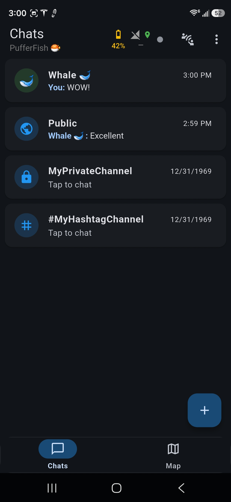
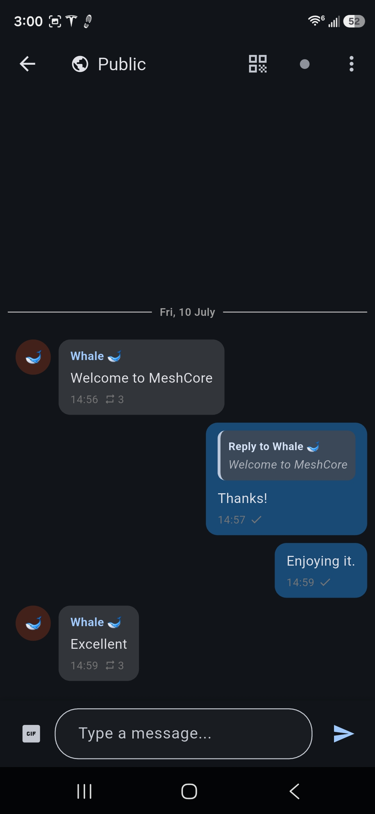
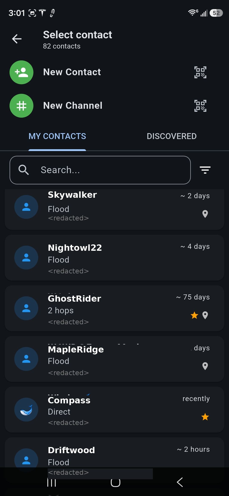
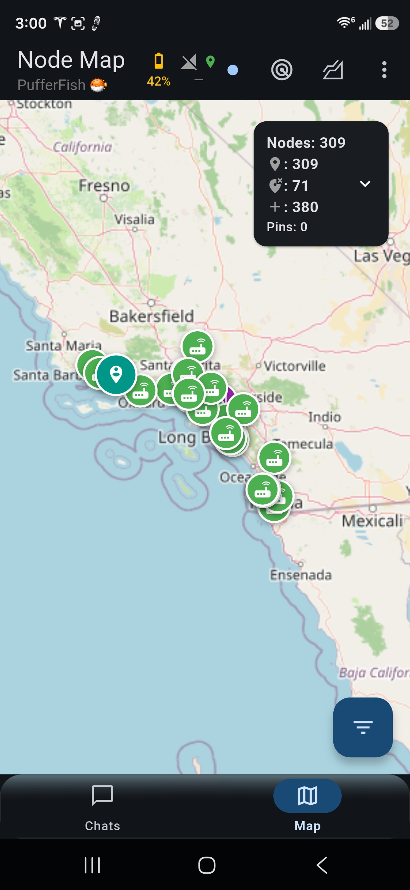

# MeshTrax

**MeshTrax** is a free, open-source client for **[MeshCore](https://meshcore.io/)** LoRa mesh-networking radios. Chat across long-range, off-grid mesh networks, without needing towers, internet, or accounts.

<a href="https://play.google.com/store/apps/details?id=com.vena.meshtrax"></a><a href="https://apps.apple.com/us/app/meshtrax/id6799214428"></a><a href="https://apps.microsoft.com/detail/9N0DM90LRH49"></a>


> **MeshTrax is UNOFFICIAL.**
> It is an independent, community-built app. It is **not** affiliated with, endorsed by, or supported by MeshCore or its creator. If you want the first-party experience, please use the **official MeshCore app** (see credits below).

---

## Credit

MeshTrax exists only because of the incredible work of the people who built the MeshCore ecosystem. Please support them:

- **[MeshCore](https://meshcore.io/)** — the open, lightweight LoRa mesh radio protocol, firmware, and official apps — is created and maintained by the MeshCore project and its community. It is the entire foundation this ecosystem, and this app, are built on. **If you want the official, best-supported experience, use the official MeshCore app, available from [meshcore.io](https://meshcore.io/).**

- **[MeshCore Open](https://github.com/zjs81/meshcore-open)** and its contributors — the open-source Flutter client that **MeshTrax is forked from.** MeshTrax builds directly on their excellent work.

MeshTrax is simply one more community client in the MeshCore world. All credit for the protocol, firmware, and official apps goes to the **MeshCore project and its creators**; all credit for the client foundation goes to **MeshCore Open** and its contributors.

Learn more about MeshCore:
- Official site: <https://meshcore.io/>
- Documentation: <https://docs.meshcore.io/>
- Protocol / firmware: <https://github.com/meshcore-dev/MeshCore>

---

## 📷 Screenshots

| Unified chats | Channel | Contacts | Node map |
|:---:|:---:|:---:|:---:|
|  |  |  |  |

---

## Features

- **Unified chat inbox** — all your direct messages and channels together in one modern, messaging-app-style conversation list (think Signal/WhatsApp), rather than scattered across separate screens.
- **Direct & channel messaging** — 1:1 messages and encrypted channels secured with pre-shared keys.
- **Rich chat** — swipe-to-reply, emoji reactions, and inline GIFs.
- **Reliable delivery** — message delivery status and automatic retry over the mesh.
- **Background notifications** — get notified of new messages even when the app is closed, with a foreground service that keeps your radio connected.
- **Contacts** — add contacts by scanning or sharing QR codes, and organize them into groups.
- **Map** — see nodes, repeaters, and neighbors on an interactive map; cache map areas for offline use; run line-of-sight terrain analysis; export tracks as GPX.
- **Telemetry** — view device and repeater sensor readings and battery levels.
- **Routing tools** — message path tracing and automatic route rotation for better delivery.
- **Moderation** — block abusive senders and report objectionable content.
- **Auto-connect** — reconnect to your last device automatically on launch.
- **Themes & languages** — light/dark themes and many localizations.

### Connect your way
- **Bluetooth Low Energy (BLE)** — wireless pairing with your radio
- **USB serial** — wired connection, where supported
- **Local network / Wi-Fi (TCP)** — connect over your network by IP

---

## Requirements

MeshTrax is a **client** — it requires a compatible **MeshCore** device (a supported LoRa radio running MeshCore firmware) to do anything useful. It is not a standalone messenger. See <https://meshcore.io/> for supported hardware and firmware.

---

## 🚀 Getting started

- **Google Play:** [Get MeshTrax on Google Play](https://play.google.com/store/apps/details?id=com.vena.meshtrax)
- **App Store (iPhone/iPad):** [Download MeshTrax on the App Store](https://apps.apple.com/us/app/meshtrax/id6799214428)
- **Microsoft Store (Windows):** [Get MeshTrax from the Microsoft Store](https://apps.microsoft.com/detail/9N0DM90LRH49)
- **Linux (Raspberry Pi & desktop):** one-line installer, see below.
- **Build from source:** see below.

### Linux (Raspberry Pi & desktop)

Install — or upgrade — with one command:

```bash
curl -fsSL https://raw.githubusercontent.com/venamartin/meshtrax/master/install.sh | bash
```

This installs MeshTrax under `~/.local/share/meshtrax`, adds it to your applications menu, and puts a `meshtrax` command on your `PATH`. No root required. Re-run the same command any time to upgrade — it checks the latest release and does nothing if you are already up to date.

Requires a **64-bit** OS: `uname -m` should print `aarch64` or `x86_64`. 32-bit Raspberry Pi OS is not supported — reflash with the 64-bit image. For USB-serial radios, add yourself to the `dialout` group:

```bash
sudo usermod -aG dialout $USER   # then log out and back in
```

To pin a specific version, or to remove MeshTrax:

```bash
curl -fsSL https://raw.githubusercontent.com/venamartin/meshtrax/master/install.sh | bash -s -- --version v1.7.22
curl -fsSL https://raw.githubusercontent.com/venamartin/meshtrax/master/install.sh | bash -s -- --uninstall
```

### Build from source

MeshTrax is a [Flutter](https://flutter.dev/) app.

```bash
# Install dependencies
flutter pub get

# Run on a connected device
flutter run

# Build an Android APK
flutter build apk

# Run on Windows
flutter run -d windows

# Run on Linux
flutter run -d linux
```

---

## Reporting bugs and suggesting features

- **Found a bug?** [Open a bug report](https://github.com/venamartin/meshtrax/issues/new?template=bug_report.yml). In the app: Settings → Report a bug, under About.
- **Have an idea?** [Suggest a feature](https://github.com/venamartin/meshtrax/issues/new?template=feature_request.yml).
- **Want to send a fix?** Read [CONTRIBUTING.md](CONTRIBUTING.md) first, and open an issue to talk it over before you start a pull request.

---

## Privacy & Terms

- [Privacy Policy](docs/privacy.md)
- [Terms of Use](docs/terms.md)

MeshTrax has no accounts, no analytics, and no MeshTrax servers. Your messages, contacts, and keys are stored only on your device and exchanged only with your own MeshCore hardware and the LoRa mesh. See the Privacy Policy for the full details, including the optional map/terrain/GIF features that connect to third-party services.

---

## License

MeshTrax is released under the **MIT License**. It is a fork of [MeshCore Open](https://github.com/zjs81/meshcore-open); see [LICENSE](LICENSE) for copyright details.

## Acknowledgments

- The **[MeshCore](https://meshcore.io/)** project and its creators — the protocol, firmware, and official apps that make all of this possible.
- **[MeshCore Open](https://github.com/zjs81/meshcore-open)** and its contributors — the upstream client MeshTrax is built from.
- Built with [Flutter](https://flutter.dev/).
- Map tiles from [OpenStreetMap](https://www.openstreetmap.org/); elevation data from [Open-Meteo](https://open-meteo.com/); GIFs from [Giphy](https://giphy.com/).
